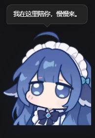
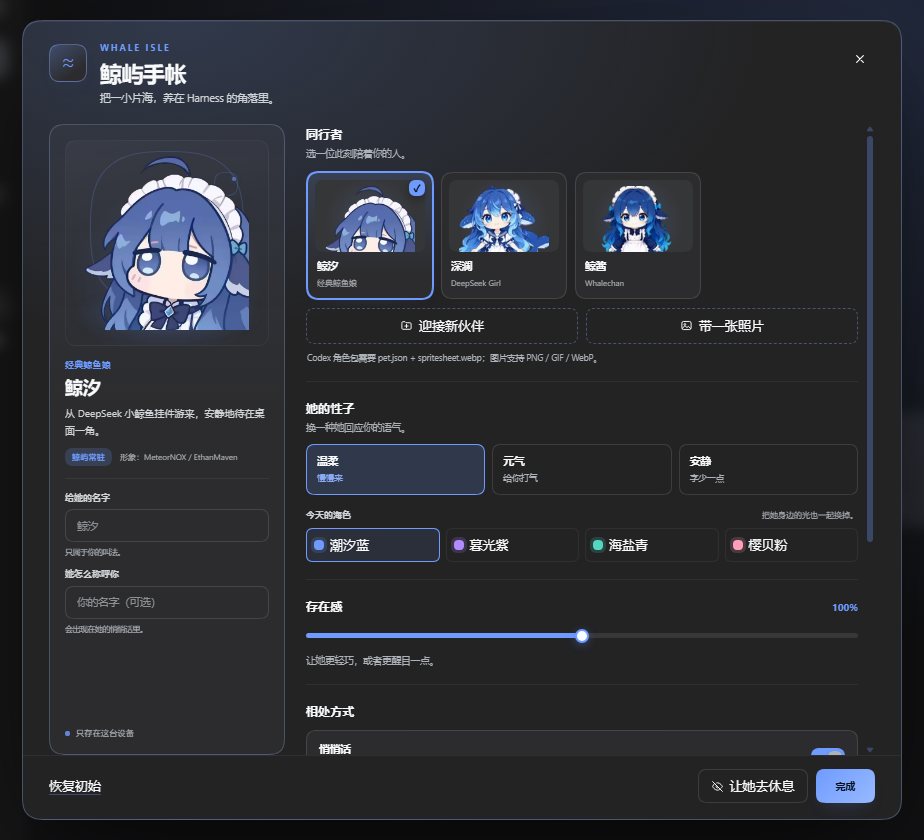
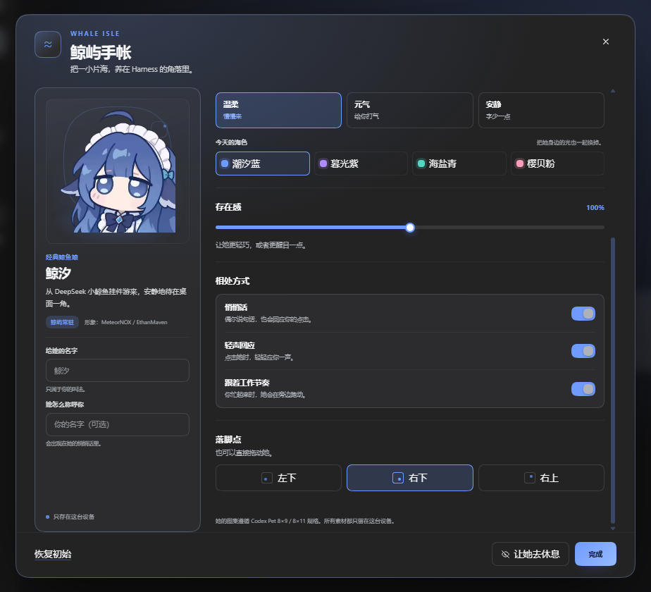

<div align="center">

# 鲸屿 · Awesome DSH Pet

**把一小片海，养在 Harness 的角落里。**

一只可个性化定制的 DeepSeek 鲸鱼娘桌宠。Codex Pet 风格 · 非独立应用 · 素材只留本机


</div>

> Harness 启动，它出现；Harness 关闭，它离开。没有单独要打开的窗口，也没有额外常驻的后台应用。



## 这个项目是什么

**鲸屿（Whale Isle）** 是 **DeepSeek Harness 的 Client 插件**。它挂载在 Harness Web UI 的 `shell.overlay` 上，所以桌宠会自然地浮在 Harness 界面右下角，跟随页面一起启动、一起关闭。

默认角色是 **鲸汐**。打开 **鲸屿手帐**，你可以：

- 给每位同行者起一个只属于自己的名字，也告诉她该怎么称呼你；
- 在「温柔 / 元气 / 安静」三种性子之间切换，让她用不同的语气回应你；
- 用「潮汐蓝 / 暮光紫 / 海盐青 / 樱贝粉」换掉她身边的光；
- 调整存在感、落脚点，或让她跟着 Harness 的工作节奏一起跑动；
- 切换内置的 **深澜（DeepSeek Girl）**、**鲸酱（Whalechan）**，或导入自己的 Codex Pet 角色包。

这个项目面向 [awesome-codex-pet](https://github.com/legeling/awesome-codex-pet) 的图集规格做了兼容，但不是 Codex 官方项目，也与 DeepSeek / OpenAI 没有隶属关系。

## 鲸屿手帐

不是一张冷冰冰的设置表单，而是她的房间。角色、称呼、语气、海色和位置都收在同一页，改动会立即生效并保存在本机。

| 可以调 | 会变成什么 |
| --- | --- |
| **给她的名字** | 角色卡片、预览和桌宠标题都使用你的叫法 |
| **她怎么称呼你** | 在悄悄话和点击回应里出现你的名字 |
| **轻声回应** | 点击时播放原挂件的两段小鲸鱼应答声，可随时关闭 |
| **她的性子** | 温柔 / 元气 / 安静，三套不同的回应语气 |
| **今天的海色** | 手帐高亮、选中状态、滑杆与桌宠光晕一起换色 |
| **存在感** | 65%–135% 的大小 |
| **落脚点** | 左下 / 右下 / 右上，或直接拖动 |

<p align="center">
  
</p>

<p align="center">
  
  <br>
  <sub>继续向下，是存在感、悄悄话、轻声回应和落脚点。</sub>
</p>

## 内置角色

Harness 启动后默认出现的是 **鲸汐**。打开鲸屿手帐，可以在三位初始角色之间切换，不需要额外下载。

| 角色 | 来源 | 授权 |
| --- | --- | --- |
| **鲸汐 / Whale Girl**（默认） | [DeepSeek-Whale-widget-desktop](https://github.com/comreade-123/DeepSeek-Whale-widget-desktop) 的鲸鱼娘形象 | MIT |
| **深澜 / DeepSeek Girl** | [awesome-codex-pet](https://github.com/legeling/awesome-codex-pet) / [legeling](https://github.com/legeling) | CC BY-NC 4.0 |
| **鲸酱 / Whalechan** | [awesome-codex-pet](https://github.com/legeling/awesome-codex-pet) / [qimi](https://github.com/qishichuan) | CC BY-NC 4.0 |

内置图片经过裁切、缩放和重新打包，具体来源、署名和修改说明见 [ASSETS-LICENSE.md](ASSETS-LICENSE.md)。其中 CC BY-NC 素材仅限非商业使用，**不适用**于本仓库代码的 MIT 许可。

## 特性

- **随 Harness 一起出现**：注册为 immediate Client 插件，无需单独启动。
- **Codex Pet 图集兼容**：读取 `pet.json` + `spritesheet.webp`，支持 v1（1536×1872，8×9）与 v2（1536×2288，8×11）。
- **会看状态的小家伙**：任务进行时跑动，等待确认时守候，一轮结束时检查，点击时挥手。
- **轻声回应**：点击时播放原挂件的双段小鲸鱼音效，可在手帐里关闭。
- **位置与尺寸记忆**：可以按住拖动，位置写入本地设置；刷新或重启后仍然在原处。
- **个性化手帐**：昵称、称呼、性格语气、主题色和位置预设都能调，且只保存在本机。
- **三种角色来源**：内置角色、Codex 角色包、单张图片；支持删除、缩放、恢复默认位置。
- **本地优先**：角色 Blob 存放在 IndexedDB，设置有 localStorage；不上传任何素材。
- **跟随主题**：界面使用 Harness 的 `--dsw-alias-*` 主题变量，深色 / 浅色模式都能融入。

悬停角色右上角会出现手帐齿轮与休息按钮。打开手帐，就能把她调成只属于你的样子。

## 在 DSH 中安装

### 环境要求

- 已安装 **DeepSeek Harness Desktop**（开发验证基于 `0.2.1-rc.2`）
- Windows 10 / 11（当前实际验证平台；其他平台欢迎反馈）
- Git

### 1. 克隆仓库

```powershell
git clone https://github.com/yanzhuang-h/awesome-dsh-pet.git
```

把仓库放到一个自己方便维护的目录，例如 `E:\Projects\awesome-dsh-pet`。

> 下面命令里的 `E:\Projects\awesome-dsh-pet` 要换成你机器上实际的克隆路径。

### 2. 使用 Harness 自带的 dsh 命令安装

`desktop` 是桌面端保留 profile，必须使用 **Harness 安装目录里的** `dsh.cmd`。把下面的 DSH 路径替换成你的实际安装位置：

```powershell
$DSH = "D:\deepseekharness\resources\runtime\cli\bin\dsh.cmd"
& $DSH plugin --profile desktop add "link:E:\Projects\awesome-dsh-pet"
```

如果你的 `dsh` 已经在 PATH 中，也可以：

```powershell
dsh plugin --profile desktop add "link:E:\Projects\awesome-dsh-pet"
```

命令会完成两件事：

1. 把插件包链接（`link:`）到 `desktop` profile；
2. 把 `awesome-dsh-pet` 加进该 profile 的 bundle 列表并启用。

### 3. 刷新或重启 Harness

新加入的 Client 插件需要重新加载一次页面才会进入启动模块图：

- 在 Harness 窗口按 `Ctrl+R`，或者
- 完全退出 Harness 后重新启动。

之后每次启动 Harness，桌宠都会自动出现。可以在 Harness 的 **插件** 页面确认 `awesome-dsh-pet` 在已安装 / 已启用列表中。

> 为什么不能直接双击一个 HTML 或运行 `npm start`？因为这个项目是 Harness 插件，依赖 Harness 的 Client Slot、主题和会话状态；它不启动独立窗口。

### 更新

因为安装方式是 `link:` 指向本地仓库，更新只需：

```powershell
cd E:\Projects\awesome-dsh-pet
git pull
```

然后按 `Ctrl+R` 刷新 Harness 页面。若更新涉及 `package.json` 的 manifest，刷新或重启一次 Harness 即可。

### 卸载

在 Harness 的 **插件** 页面停用并移除 `awesome-dsh-pet`。如果使用命令行：

```powershell
& $DSH plugin --profile desktop remove awesome-dsh-pet
```

如果「已启用插件」里仍保留条目，在插件页面关闭它即可。角色设置和导入素材可选择在浏览器站点数据中清除。

## 使用

| 操作 | 效果 |
| --- | --- |
| 悬停角色 | 显示设置齿轮和隐藏按钮 |
| 单击角色 | 开心表情 / 动作 + 随机回应（可在手帐里关闭声音） |
| 按住拖动 | 移动桌宠，松手后保存位置 |
| 点击气泡 | 收起当前回应 |
| 设置齿轮 | 打开「鲸屿手帐」 |
| 隐藏按钮 / 手帐里的「让她去休息」 | 收成右下角的小胶囊「叫她回来」，点击可唤醒 |
| 任务运行 / 等待确认 / 结束 | `running` / `waiting` / `review` 动作 |

任务状态来自 Harness 的 Session 状态；如果同时有多个 Session 在运行，任意一个运行都会让桌宠进入跑动状态。

## 自定义角色

悬停桌宠右上角，点齿轮 → **鲸屿手帐**。

### 方式一：导入 Codex Pet 角色包（推荐，有完整动作）

1. 准备一个文件夹，至少包含：
   ```text
   my-pet/
   ├─ pet.json
   └─ spritesheet.webp
   ```
2. 在「鲸屿手帐」点击 **迎接新伙伴**，选择这个文件夹。
3. 导入成功后会立即换上新角色，并可在角色卡片之间切换。

`pet.json` 示例：

```json
{
  "id": "my-pet--me",
  "displayName": "小星",
  "description": "一只住在桌面上的小星星。",
  "spriteVersionNumber": 1,
  "spritesheetPath": "spritesheet.webp"
}
```

支持的图集规格：

| 版本 | 尺寸 | 布局 | 说明 |
| --- | --- | --- | --- |
| v1 | 1536 × 1872 | 8 列 × 9 行 | 标准动作 |
| v2 | 1536 × 2288 | 8 列 × 11 行 | 标准动作 + 两行环视方向 |

单文件上限 12 MB。图集尺寸不符合 `spriteVersionNumber` 时会拒绝导入并提示原因。v2 的最后两行环视方向目前不参与交互，标准九行动画会正常播放。

社区角色包可以从 [awesome-codex-pet](https://github.com/legeling/awesome-codex-pet) 或 [codexpet.top](https://codexpet.top) 获取。**角色素材的版权与许可属于各自作者，本项目不打包、不再分发这些素材。**

### 方式二：导入一张图片 / GIF

点击 **带一张照片**，选择 PNG / GIF / WebP：

- 透明背景效果最好；
- 静态图片会加上轻微呼吸与点击弹跳；
- GIF 保留自身的动画节奏。

如果文件名是 `idle`、`spritesheet`、`image` 这类通用名称，角色会显示为「我的角色」，可以重新命名文件后再导入。

### 数据在哪里

- 设置：Harness Web 页面的 `localStorage`，键名 `dsh-pet.settings.v1`
- 角色：Harness Web 页面的 IndexedDB，数据库 `dsh-pet.pets.v1`
- 自定义角色只在你的机器上；插件没有任何上传或统计请求。

## 开发

项目没有运行时依赖，只有 Node 内置模块与 Harness 提供的 React / Slot API。

```powershell
npm run build     # src/client.js + src/builtins/* → client.js
npm run check     # manifest / 导出 / 图标 / 语法检查
```

目录：

```text
awesome-dsh-pet/
├─ client.js            # 构建产物：Client 半，注册到 shell.overlay
├─ src/
│  ├─ client.js         # 可维护源码
│  └─ builtins/         # 三位内置角色的图片 / 图集
├─ index.js             # Host 半，空实现
├─ cordis.patch.yml     # 插入 awesome-dsh-pet 这一行
├─ package.json         # bundle + Client manifest
├─ icon.png             # 插件图标
├─ locale/{en,zh}.json  # Plugin Manager 显示元数据
├─ docs/                # README 截图
└─ tools/
   ├─ build.mjs
   └─ check.mjs
```

修改 `src/client.js` 或 `src/builtins/*` 后运行 `npm run build`。如果要修改动画，请参考 `src/client.js` 里的 `SPRITE` 表和 `PetOverlay` 状态映射。新增内置角色时，请同步更新本文件、`ASSETS-LICENSE.md` 和构建脚本中的素材列表。

Built and tested against DeepSeek Harness `0.2.1-rc.2`. DSH 的 Client Slot、主题 token 和插件 manifest 仍处于预览阶段，升级 Harness 后可能需要同步适配。

## Roadmap

- [ ] v2 环视方向：让角色跟随鼠标转头
- [ ] 直接列出本机 `~/.codex/pets` 中已安装的角色
- [ ] 拖放导入、ZIP 导入
- [ ] 每个角色独立台词 / 声音
- [ ] 更多内置角色与动作
- [ ] 浅色主题细节打磨与多语言完善
- [ ] 一键安装脚本 / 插件市场条目

欢迎通过 Issues 提功能建议。会优先做**能把角色玩得更有生命力**的功能。

## 参与贡献

- Bug 反馈、角色包兼容问题、功能建议：欢迎开 [Issue](https://github.com/yanzhuang-h/awesome-dsh-pet/issues)。
- 代码和角色贡献：请先看 [CONTRIBUTING.md](CONTRIBUTING.md)。
- 版本变化：[CHANGELOG.md](CHANGELOG.md)。

如果这个项目让你的桌面多了一点快乐，欢迎点一个 Star ⭐

## 常见问题

**安装完刷新了，桌宠没有出现？**
先确认 Harness 的 **插件** 页面里 `awesome-dsh-pet` 已启用；如果刚刚安装，完全退出并重新打开 Harness 最稳妥。也可以在页面按 `Ctrl+R` 后再等几秒。

**安装命令提示 desktop profile 只能由 Electron 管理？**
请使用 Harness 安装目录中的 `resources\runtime\cli\bin\dsh.cmd`，不要使用全局 npm 安装的 `dsh` 命令。

**迎接新伙伴时提示图集尺寸不符？**
检查 `spriteVersionNumber` 与图集尺寸是否匹配（v1 1872 高，v2 2288 高），以及是否漏了 `spritesheet.webp`。本项目只接受 8 列的 Codex Pet 图集。

**桌宠挡住了输入框？**
拖动它到其他位置，或点击悬停时的隐藏按钮。位置会保存。

**点击没有声音？**
打开鲸屿手帐，确认 **轻声回应** 已开启；同时检查系统和 Harness 是否静音。音效需要一次真实点击/键盘操作后才会播放，这是浏览器的自动播放限制。

**可以商用吗？**
插件代码是 MIT；但内置的 DeepSeek Girl 和 Whalechan 素材是 CC BY-NC 4.0，所以**包含它们的发行版不能直接商用**。商业使用请移除这两个素材并重新构建，或联系原作者取得授权，详见 [ASSETS-LICENSE.md](ASSETS-LICENSE.md)。

**如何彻底移除？**
在插件页面移除插件；如需要，再清除 Harness 站点的 localStorage / IndexedDB 数据。

## 致谢与声明

- 默认「鲸汐 / Whale Girl」形象来自 [DeepSeek-Whale-widget-desktop](https://github.com/comreade-123/DeepSeek-Whale-widget-desktop)，遵循其 MIT 许可。
- 点击音效 `Ya1.mp3` / `Ya2.mp3` 同样来自该挂件仓库，遵循其 MIT 许可；本项目将其重命名为 `click-press.mp3` / `click-release.mp3` 并嵌入 Client bundle。
- **深澜（DeepSeek Girl）** 由 [legeling](https://github.com/legeling) 创作，**鲸酱（Whalechan）** 由 [qimi](https://github.com/qishichuan) 创作，均来自 [awesome-codex-pet](https://github.com/legeling/awesome-codex-pet)。
- 角色格式与动画灵感来自 Codex Pet 社区，感谢其开放的图集规范。
- 插件代码、鲸屿手帐与界面整合由 [yanzhuang-h](https://github.com/yanzhuang-h) 维护。
- 这是一个社区项目，与 DeepSeek、OpenAI、Codex 官方均无隶属关系；内置角色是社区形象 / 非官方演绎。

## License

**代码**以 [MIT](LICENSE) 许可发布。**内置角色美术**不属于 MIT 代码许可：鲸汐 / Whale Girl 素材遵循上游 MIT / 署名要求；DeepSeek Girl 与 Whalechan 遵循 **CC BY-NC 4.0**，仅限非商业使用。

因此，包含全部内置素材的发行版整体应按**非商业用途**使用；如需商业使用，请移除 CC BY-NC 素材或联系原作者取得授权。完整说明见 [ASSETS-LICENSE.md](ASSETS-LICENSE.md)。导入的社区角色素材不属于本项目，遵循各自作者 / 角色包的许可。
